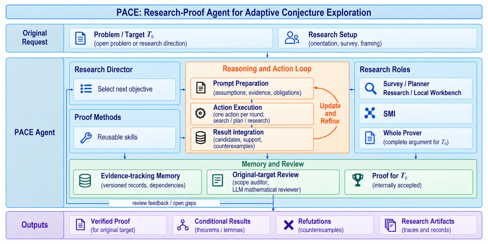

# PACE

**Research Proving Agent for Adaptive Conjecture Exploration**

[English](README.md) · [简体中文](README.zh-CN.md)

[Paper (arXiv)](https://arxiv.org/abs/2610.33690) · [Featured achievements](#featured-achievements) · [Quick start](#quick-start) · [Installation](docs/installation.md) · [User guide](docs/user-guide.md) · [Results](docs/results/README.md)

PACE is a natural-language research agent for **open mathematical conjectures**. It develops candidate statements and proofs together: formulating precise questions, testing supporting arguments, searching for counterexamples, and assembling findings into proofs. Investigations can continue across multiple turns, carrying forward established results with their assumptions and turning unresolved steps into the next research objectives.

**Try PACE online:** You can try PACE on [Reaslab](https://reaslab.io/).

## Researching open conjectures

Open-conjecture research couples **what can be established** with **how to establish it**. PACE investigates candidate statements, constructions, bounds, and counterexamples, especially in applied mathematics and optimization. It also supports direct proof tasks with fixed statements.

- **Develop conjectures and proofs together.** Use new arguments, failed attempts, and counterexamples to refine the next research objective.
- **Keep conclusions tied to their assumptions.** Preserve established results with the conditions and evidence that support them.
- **Continue a line of research.** Carry findings and unresolved questions across turns, with independent review against the original goal.

The [research workflow](#research-workflow) explains how these activities fit together.

## Featured achievements

These two investigations highlight PACE's work on a classical convergence-order question and a recent open problem in optimization dynamics. Two further complexity results are summarized below, with links to the full case pages.

### 1. BFGS: a convergence-order question spanning over 40 years

**The open question.** The question dates to Powell's 1983/1984 work on exact-line-search variable-metric methods. [Yuan (1984)](https://lsec.cc.ac.cn/pub/yyx/papers/1984IMAJNA-4-233-239.pdf) established an infimum Q-order of one in the $C^2$ convex class, using a family of examples whose orders approach one. Can a single infinitely smooth, strongly convex objective and a single trajectory attain that boundary?

**What PACE solved.** For every fixed dimension $n\ge2$, PACE constructs a globally $C^\infty$, globally strongly convex objective and a nonterminating exact-line-search BFGS trajectory converging to its unique minimizer, with

> **Minimum Q-order $\rho_n=1$, attained by one fixed objective and one fixed trajectory.**

**Why it matters.** The advance is from a family approaching the boundary to one smooth, strongly convex instance attaining it. The trajectory is Q-superlinear, yet no fixed exponent $p>1$ gives an eventual adjacent-error power bound. This answers the smooth, strongly convex attainment question in a line of research dating back more than four decades.

[Case details (Markdown)](docs/results/bfgs-q-order.md) · [Paper and historical context](https://arxiv.org/abs/2609.00596)

---

### 2. Heavy-Ball: answering a dynamics riddle posed in 2025

**The open question.** In [*Two Riddles in Heavy-Ball Dynamics* (2025), §3](https://arxiv.org/html/2502.19916v1#S3), Goujaud, Taylor, and Dieuleveut ask what happens when Heavy-Ball parameters admit neither their specified two-point linear/quadratic Lyapunov certificate nor a nonconstant periodic orbit. Can the method still converge globally?

**What PACE solved.** With $q=\mu/L$, $a=L\gamma$, and $b=\beta$, PACE identifies

$$
(q,a,b)=\left(\frac1{100},\frac{113}{50},\frac35\right),
$$

where neither the specified certificate nor any nonconstant finite cycle exists. PACE also establishes **global linear convergence throughout the closed box of coordinate radius $10^{-5}$ around this point**, for every corresponding strongly convex, smooth objective, every finite dimension, and every initial pair.

**Why it matters.** This answers the second riddle by exhibiting a globally convergent regime beyond the specified certificate family. The result separates the reach of that family from the actual convergence of Heavy-Ball, with a guarantee covering a parameter neighborhood and the entire corresponding function class.

[Case details (Markdown)](docs/results/heavy-ball-dynamics.md) · [Original open problem](https://arxiv.org/html/2502.19916v1#S3)

### Additional results

| Investigation | Result and significance | Markdown |
|---|---|---|
| Fixed-path stochastic optimization | A lower bound combining statistical estimation and network propagation matches the upper bound's principal polynomial dependencies for local linear-span methods on a fixed lazy path. Both costs persist with zero local heterogeneity at the optimum. | [Case details](docs/results/path-network-lower-bound.md) |
| Stochastic bilevel optimization | The optimal precision exponent is **two**, with a single logarithmic gap between upper and lower bounds, under the specified state-independent additive-noise, same-sample oracle and per-return accounting. | [Case details](docs/results/bilevel-additive-noise.md) |

[All four problem statements, results, and references](docs/results/README.md).

## Research workflow

[](docs/assets/pace-overview.png)

When `--mode` is omitted, the first target-location call selects `proof` only for tasks suited to direct proving; tasks requiring mechanism exploration, or uncertainty about suitability, select `research`. You can set either mode explicitly. Research follows the loop below; proof runs one initial Survey and up to five successive proof-and-review loops, stopping once verified.

1. **Plan and gather sources.** The Director selects objectives and chooses between local exploration and deeper investigation; the Planner develops the mathematical route. Survey gathers literature and can optionally use [ReasAtlas](https://atlas.reaslab.io) for mathematical source retrieval through a separately supplied client and Skill; see [retrieval configuration](docs/configuration.md#reasatlas-source-retrieval).
2. **Refine conjectures and their supporting arguments.** The conjecture-refinement process, SMI, develops candidate statements and mechanisms: intermediate claims intended to establish them. It checks whether the claims are justified without circular reasoning and whether they cover the full candidate. Proof attempts and counterexample searches distinguish an unsupported argument from a false statement, guiding repair, revision, or decomposition within the original request.
3. **Construct and review proofs.** The Prover assembles the relevant arguments. Auditor and Kernel independently review the candidate proof against the original target using model-based natural-language verification.
4. **Retain evidence for the next task.** Versioned memory records results separately from their uses, preserving assumptions, scope, sources, dependencies, and review findings. Changes to a candidate or condition trigger renewed review of affected evidence; established results retain their original conditions. Reuse requires checking those conditions and the argument connecting the old conclusion to its new use. Missing steps and failed routes guide the next objective, with checked premises, exploratory material, and unresolved obligations kept distinct in task-specific context.
5. **Report and continue.** Checked findings update progress as the research proceeds. After every completed proof or research turn, one saved delivery sequence writes a Chinese report and an English paper, independently reviews each manuscript, makes necessary revisions, and builds the PDF. Explicit writing commands can request later new versions. The separate Reaslab Web application is not included in this repository; CLI users read and copy the files listed below. [Resume](docs/user-guide.md#resume-an-interrupted-turn) continues unfinished stages while reusing completed work; [continue](docs/user-guide.md#continue-with-a-new-question) starts a new turn with prior findings.

## Quick start

### 1. Install PACE

Requirements: **Python 3.11+** and **Codex CLI** with access to your chosen model. The Python runtime has no third-party dependencies; Codex is installed separately. Automatic paper delivery needs `xelatex`, BibTeX, and `pdffonts`; see [PDF tools](docs/installation.md#paper-pdf-tools).

The commands below use Bash. Run PACE on macOS/Linux or, on Windows, inside WSL; see the [environment requirements](docs/installation.md#requirements).

Get the `main` source branch, then install it. Use a `python3` reporting version 3.11 or later; otherwise replace it with your installed supported interpreter before creating the environment.

```bash
git clone https://github.com/optpku/PACE.git
cd PACE
python3 --version
python3 -m venv .venv
source .venv/bin/activate
python -m pip install .
pace --help
```

If you already downloaded this branch, start from its directory containing `pyproject.toml`. Installation may download Python build tools. `pace --help` checks the entry point without calling a model. For a locked installation with uv, see [Installation](docs/installation.md).

### 2. Prepare Codex

If Codex is not installed, use the [official installation guide](https://developers.openai.com/codex/cli). With npm already installed:

```bash
npm install -g @openai/codex
```

Then check the CLI in the same shell:

```bash
codex --version
codex login status
```

If sign-in is needed, run `codex login`. Custom provider and executable settings are covered in [Configuration](docs/configuration.md).

PACE reuses the login and isolates role calls from personal Codex memories, plugins, hooks and directory instructions. Only Survey can retrieve external sources. `--web-search-mode on` (default) enables Survey retrieval; `off` disables it. All other roles always have retrieval disabled, with no option to enable it; blind probes also retain their restricted local context. Use a recent CLI supporting `codex exec --ignore-user-config`; `pace doctor` checks compatibility before inference.

PACE runs Codex with `--dangerously-bypass-approvals-and-sandbox` for unattended tasks. Use an environment whose filesystem and command access you intend to grant to the agent; see [execution permissions](docs/installation.md#requirements).

### 3. Prepare PDF tools

For automatic paper delivery, install a TeX distribution and Poppler providing `xelatex`, `bibtex` and `pdffonts`; follow [PDF tool setup](docs/installation.md#paper-pdf-tools). If PDF tools are missing, the reviewed source remains saved and delivery pauses for `resume`.

### 4. Check the environment

In the same terminal, with the PACE environment active, run:

```bash
pace doctor
```

This checks Python, POSIX utilities and Codex compatibility without calling a model. Also run `pace doctor --pdf` to check the PDF toolchain and compile a small local document. That check may take a few minutes. Neither check verifies model access; the example below exercises a live model call.

### 5. Run the included example

Before starting a research problem, try the small [parity example](examples/quickstart/EVEN_SQUARE.md):

```bash
pace run \
  --problem examples/quickstart/EVEN_SQUARE.md \
  --problem-id even-square --output outputs \
  --mode proof \
  --model gpt-6.1-sol --reasoning-effort high \
  --web-search-mode on
```

This command makes model calls. Choose a model/effort pair available to your account. The example uses proof mode: one initial Survey (with search available when needed), direct proving and independent verification. After the proof ends, the same turn runs report and paper delivery, including independent editorial review. Read `outputs/even-square/work/turn001/outcome.md` and the same turn's `final_report.json` for the factual outcome and verification references. `--max-proof-states` caps proof states, not total calls, time, or cost; see [budgets](docs/configuration.md).

## Investigate your conjecture

Save a self-contained UTF-8 Markdown problem as `conjecture.md`, stating its objective, assumptions, allowed outcomes, and starting points. Start a study with a model and effort supported by your account:

```bash
pace run --problem conjecture.md --problem-id my-conjecture --output outputs \
  --mode research \
  --model gpt-6.1-sol --reasoning-effort high --web-search-mode on
```

List your research topics, then read the current turn's `outcome.md` and `final_report.json` under `outputs/my-conjecture/work/`:

```bash
pace problems --output outputs
```

The user guide covers [report and paper writing](docs/user-guide.md#write-a-report-or-paper), [batch execution](docs/user-guide.md#run-a-batch), and [recorded result summaries](docs/user-guide.md#summarize-recorded-results). See [Configuration](docs/configuration.md) for models, retrieval, budgets, custom providers, and paper styles.

## Read the research output

PACE saves mathematical originals, checkpoints, factual runtime records and reviewed manuscripts. These files are usable directly from the CLI; the separate Web application is optional.

| Output | What it provides |
|---|---|
| `work/turnNNN/outcome.md` | Factual outcome and original evidence links for this turn. |
| `work/turnNNN/final_report.json` | Bound mathematical result, mode selection and execution status. |
| `results/findings/` | Independently checked manuscripts with their verification references. |
| `results/outline.md`, `results/research_report.md` | Chinese report outline and independently reviewed report. |
| `results/paper_outline.md`, `results/paper/main.tex`, `main.pdf` | English paper outline and independently reviewed manuscript; PDF exists only after a successful build. |
| `work/turnNNN/state/terminal_delivery.json` | Saved automatic writing, review and delivery progress for this turn. |

Reports and papers preserve the original hypotheses, proof scope and open gaps. Read [writing instructions](docs/user-guide.md#write-a-report-or-paper) for the two writing paths and [recorded result summaries](docs/user-guide.md#summarize-recorded-results) for batch inspection. Mathematical acceptance is separate from writing completion and Web delivery.

## License and citation

[Apache License 2.0](LICENSE). Inherited license notices are preserved in [NOTICE](NOTICE) and [LICENSES](LICENSES). Software citation metadata is maintained in [CITATION.cff](CITATION.cff).

If you use PACE in your research, please cite:

Shu Miao, Feiming Wang, Wentao Long, Chenyi Li, Kun Yuan, and Zaiwen Wen. [*PACE: Research Proving Agent for Adaptive Conjecture Exploration*](https://arxiv.org/abs/2610.33690). arXiv:2610.33690, 2026.

```bibtex
@misc{miao2026paceresearchprovingagent,
  title={PACE: Research Proving Agent for Adaptive Conjecture Exploration},
  author={Shu Miao and Feiming Wang and Wentao Long and Chenyi Li and Kun Yuan and Zaiwen Wen},
  year={2026},
  eprint={2610.33690},
  archivePrefix={arXiv},
  primaryClass={cs.AI},
  url={https://arxiv.org/abs/2610.33690},
}
```

## Acknowledgements

We thank [MathResearchPrompts](https://github.com/optsuite/MathResearchPrompts) for ideas on prompt design.

We thank [VeryMath AI4Math-Writing](https://github.com/VeryMath/AI4Math-Writing/tree/main/skills/paper-writing), [Tianhua Gao's math-prose](https://github.com/TianhuaGao/math-prose), and [Haruhisa Enomoto's math-paper-skills](https://github.com/haruhisa-enomoto/math-paper-skills) for ideas on mathematical writing that informed PACE's manuscript guidance.
