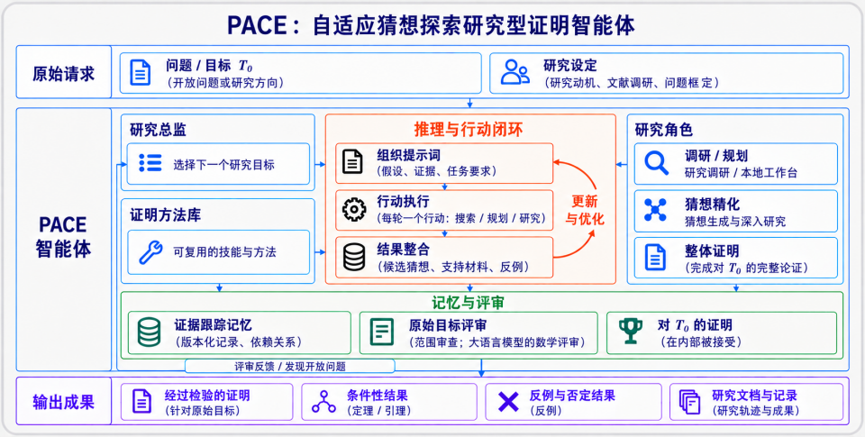

# PACE

**Research Proving Agent for Adaptive Conjecture Exploration**

**面向开放猜想的自适应研究与证明 agent**

[English](README.md) · [简体中文](README.zh-CN.md)

[论文（arXiv）](https://arxiv.org/abs/2610.33690) · [标志性成果](#标志性成果) · [快速开始](#快速开始) · [安装说明](docs/installation.md) · [使用手册](docs/user-guide.md) · [结果总览](docs/results/README.md)

PACE 是面向**开放数学猜想**的自然语言研究 agent。它同步推进候选命题与证明：提出精确问题、检验关键论证、寻找反例，并将局部发现组织为完整证明。研究可以跨多轮任务持续进行，已有结论连同其成立条件被保留，尚未解决的步骤成为下一轮的研究目标。

**在线试用：** 你可以在 [Reaslab](https://reaslab.io/) 中试用 PACE。

## 面向开放猜想的研究

开放猜想研究需要同时回答：**什么结论能够成立，以及如何证明它。** PACE 研究候选命题、数学构造、上下界与反例，尤其面向应用数学和优化，也支持陈述已确定的直接证明任务。

- **让猜想与证明共同推进。** 根据新论证、失败尝试和反例，调整下一步研究目标。
- **让结论携带成立条件。** 保留已确立的结果，以及支撑它们的假设和证据。
- **持续推进一条研究路线。** 跨轮次积累发现与未解决问题，并针对原始目标进行独立审查。

各环节如何衔接，见下文[研究流程](#研究流程)。

## 标志性成果

以下两项成果分别展示 PACE 对经典收敛阶问题和近期优化动力学开放问题的研究。另两项复杂度结果汇总在表格中，可通过链接阅读完整案例。

### 1. BFGS：延续四十余年的收敛阶问题

**开放问题。** 这一问题源于 Powell 在 1983/1984 年对精确线搜索变尺度法的研究。[Yuan（1984）](https://lsec.cc.ac.cn/pub/yyx/papers/1984IMAJNA-4-233-239.pdf)在 $C^2$ 凸函数类中证明 Q 阶下确界为 1，构造了一族收敛阶趋近于 1 的例子。一个无限光滑、强凸目标函数和一条固定轨迹，能否真正达到这一边界？

**PACE 解决了什么。** 对每个固定维数 $n\ge2$，PACE 构造一个全局 $C^\infty$、全局强凸目标函数，以及一条收敛到其唯一极小点的非终止精确线搜索 BFGS 轨迹，使得

> **最小 Q 阶 $\rho_n=1$，且由一个固定目标函数和一条固定轨迹达到。**

**研究意义。** 关键推进是从“一族例子趋近边界”到“一个光滑强凸实例达到边界”。该轨迹 Q 超线性收敛，却不满足任何固定 $p>1$ 的最终相邻误差幂次界。这回答了光滑强凸情形下的边界可达性问题，推进了源自四十余年前的收敛阶研究。

[案例详情（Markdown）](docs/results/bfgs-q-order.md) · [论文与历史背景](https://arxiv.org/abs/2609.00596)

---

### 2. Heavy-Ball：回答 2025 年提出的动力学开放问题

**开放问题。** Goujaud、Taylor 与 Dieuleveut 在 [*Two Riddles in Heavy-Ball Dynamics*（2025）第 3 节](https://arxiv.org/html/2502.19916v1#S3)提出：当 Heavy-Ball 参数既没有指定的两点线性／二次 Lyapunov 证书，也没有非恒定周期轨道时，算法会怎样演化？它是否仍能全局收敛？

**PACE 解决了什么。** 令 $q=\mu/L$、$a=L\gamma$、$b=\beta$，PACE 给出明确参数点

$$
(q,a,b)=\left(\frac1{100},\frac{113}{50},\frac35\right),
$$

并证明在该点，指定证书与任何非恒定有限周期轨道均不存在。进一步，PACE 证明**以该点为中心、三个坐标半径均为 $10^{-5}$ 的闭盒内，算法全局线性收敛**，适用于任意相应强凸光滑目标、任意有限维数和任意初始点对。

**研究意义。** 这以明确的全局收敛区域回答了第二个动力学问题，将指定证书族的适用范围与 Heavy-Ball 实际的收敛行为区分开来。保证覆盖一个参数邻域及相应的整个函数类。

[案例详情（Markdown）](docs/results/heavy-ball-dynamics.md) · [原开放问题](https://arxiv.org/html/2502.19916v1#S3)

### 其他成果

| 研究问题 | 结论与意义 | Markdown |
|---|---|---|
| 固定路径网络上的随机优化 | 对固定惰性路径上的本地线性张成方法，建立同时包含统计估计项与网络传播项的下界，与上界的主多项式依赖匹配；即使最优点处局部异质性为零，两项代价仍然存在。 | [案例详情](docs/results/path-network-lower-bound.md) |
| 加性噪声下的随机双层优化 | 在指定的状态无关加性噪声、同样本查询且逐返回计费的 oracle 模型下，确定最优精度指数为 **2**，上下界仅相差一个对数因子。 | [案例详情](docs/results/bilevel-additive-noise.md) |

[查看四项问题的完整题面、结论与参考文献](docs/results/README.md)。

## 研究流程

[](docs/assets/pace-overview.zh-CN.png)

省略 `--mode` 时，首次目标定位会判断模式：只有适合直接证明的问题选择 `proof`；需要机制探索或判断不确定时选择 `research`，也可显式指定其中一种模式。research 采用下述研究流程；proof 在一次初始 Survey 后，围绕同一证明进行最多 5 轮写作、修订与核验，通过即结束。

1. **规划与调研。** Director 选择目标，决定开展局部探索还是深入研究；Planner 制定数学路线。Survey 调研文献，也可通过单独提供的客户端与 Skill 选配 [ReasAtlas](https://atlas.reaslab.io)，检索数学来源，详见[检索配置](docs/configuration.md#reasatlas-source-retrieval)。
2. **细化猜想与支撑论证。** 猜想精化研究（Refined Conjecture Investigation，RCI）同时发展候选命题和支撑机制，即足以推出候选结论的中间命题。它检查这些命题是否有依据、是否存在循环论证，以及是否覆盖完整结论；通过证明尝试和反例搜索，区分论证尚不成立与命题本身为假，据此在原始请求范围内修补、修订或拆分问题。
3. **构造与核验证明。** Prover 组织适用论证，Auditor 与 Kernel 针对原始目标分别审查候选证明，采用基于模型的自然语言核验。
4. **保留证据，组织后续任务。** 带版本的记忆分别记录结果本身及其用途，保留假设、适用范围、来源、依赖和审查记录。候选或条件变化后，重新审查受影响的证据，已确立结果仍按原条件保留。复用前须检查这些条件，并建立旧结论通向新用途的论证。缺失步骤和失败路线指导下一步选题；任务上下文区分已核验前提、探索材料与未解决的证明义务。
5. **查看、写作与继续研究。** Host 在研究中更新事实性目录和已核验成果。研究结束后保存数学结果与证据，不自动启动长报告写作；用户可另行调用 `outline`、`report`、`paper-outline`、`paper`。提纲、报告和论文各使用一次作者任务，PDF 构建失败后可从保存的源稿恢复。[resume](docs/user-guide.md#resume-an-interrupted-turn) 复用已完成阶段；[continue](docs/user-guide.md#continue-with-a-new-question) 沿用成果开启新 turn。

## 快速开始

### 1. 安装 PACE

需要 **Python 3.11+**，以及能访问所选模型的 **Codex CLI**。Python 运行时没有第三方依赖。proof 和 research 研究流程不需要 TeX；显式论文写作另需 `xelatex`、BibTeX 和 `pdffonts`，详见 [PDF 工具安装](docs/installation.md#paper-pdf-tools)。

以下命令使用 Bash。当前在 macOS/Linux 上运行，Windows 用户请使用 WSL，详见[环境要求](docs/installation.md#requirements)。

获取 `main` 分支并安装。确认 `python3` 的版本为 3.11 或以上；若版本过低，请先换用已安装的受支持解释器，再创建环境。

```bash
git clone https://github.com/optpku/PACE.git
cd PACE
python3 --version
python3 -m venv .venv
source .venv/bin/activate
python -m pip install .
pace --help
```

若已下载该分支，从包含 `pyproject.toml` 的源码目录开始执行安装命令。安装过程可能下载 Python 构建工具。`pace --help` 检查命令入口，不调用模型。使用 uv 锁定依赖的安装方式见[安装说明](docs/installation.md)。

### 2. 配置 Codex

若尚未安装 Codex，请参考[官方安装指南](https://developers.openai.com/codex/cli)。已安装 npm 时可以执行：

```bash
npm install -g @openai/codex
```

然后在同一个终端检查：

```bash
codex --version
codex login status
```

需要登录时执行 `codex login`。自定义服务与可执行文件设置见[配置说明](docs/configuration.md)。

PACE 复用登录凭据，并将角色调用与个人 Codex 记忆、插件、hooks 和目录指令隔离。默认允许 Survey 按需检索（`--web-search-mode on`），其余角色显式关闭检索工具；可用 `off` 关闭 Survey 检索。其他角色没有开启检索的参数。请使用支持 `codex exec --ignore-user-config` 的较新版本；`pace doctor` 会在调用模型前检查兼容性。

PACE 使用 `--dangerously-bypass-approvals-and-sandbox` 调用 Codex 执行无人值守任务。请在你愿意授予 agent 文件和命令访问权限的环境中运行，具体说明见[运行要求](docs/installation.md#requirements)。

### 3. 准备 PDF 工具

用户请求论文交付时，需安装提供 `xelatex`、`bibtex` 和 `pdffonts` 的 TeX 发行版与 Poppler，详见 [PDF 工具安装说明](docs/installation.md#paper-pdf-tools)。构建失败时保留已交付源稿与诊断信息，修复环境后用 `resume` 继续。

### 4. 检查运行环境

在同一个终端、保持 PACE 环境激活的情况下执行：

```bash
pace doctor
```

这会检查 Python、POSIX 工具和 Codex 兼容性，不调用模型。需要论文交付时，再执行 `pace doctor --pdf` 检查 PDF 工具链并编译一个小型本地文档，可能需要几分钟。两种检查均不验证模型访问权限；下方示例会实际调用模型。

### 5. 运行自带示例

开始研究问题前，可以先运行简单的[奇偶性示例](examples/quickstart/EVEN_SQUARE.md)：

```bash
pace run \
  --problem examples/quickstart/EVEN_SQUARE.md \
  --problem-id even-square --output outputs \
  --mode proof \
  --model gpt-6.1-sol --reasoning-effort high \
  --web-search-mode on
```

这条命令会调用模型，请使用账号支持的模型与推理强度。proof 模式起证前做一次 Survey，再直接证明与独立核验，不调用 Director 或 RCI；写作由用户另行请求。从 `outputs/even-square/README.md` 开始查看，`work/turn001/final_report.json` 保存数学结论和证据。`--max-proof-states` 限制证明状态数，不限制总调用次数、时长或费用，详见[预算配置](docs/configuration.md)。

## 研究你的猜想

将自含问题保存为 UTF-8 Markdown 文件 `conjecture.md`，写明研究目标、假设、允许的结果及已有起点。使用账号支持的模型与推理强度启动研究：

```bash
pace run --problem conjecture.md --problem-id my-conjecture --output outputs \
  --mode research \
  --model gpt-6.1-sol --reasoning-effort high --web-search-mode on
```

列出研究主题，并打开 `outputs/my-conjecture/README.md` 查看当前 turn、成果与已完成的报告和论文：

```bash
pace problems --output outputs
```

[文稿修订](docs/user-guide.md#write-a-report-or-paper)、[批量执行](docs/user-guide.md#run-a-batch)及[结果汇总](docs/user-guide.md#summarize-recorded-results)见用户手册；模型、检索、预算、自定义服务和论文样式见[配置说明](docs/configuration.md)。

## 阅读研究输出

PACE 保存数学原稿、断点、运行记录及作者交付的文稿。CLI 用户可以直接打开或复制下列文件；Reaslab 网页应用单独提供，不包含在此仓库内。

实验、turn 和 `round0001` 的目录页链接任务、成果、核验与调用日志。`results/` 提供当前阅读入口，`work/turnNNN/` 保留历史原稿；同一成果更新后沿用稳定编号。新实验保存固定运行代码供恢复，旧实验保留原布局。详见[实验文件结构](docs/user-guide.md#experiment-files)，可用 `pace index` 在不调用模型的情况下重建目录页。

| 输出 | 内容 |
|---|---|
| `README.md`、`work/turnNNN/README.md`、`roundNNNN/README.md` | Host 生成的实验、turn 和调度轮次入口，不调用模型。 |
| `work/turnNNN/final_report.json` | 数学结论、模式选择及研究执行状态。 |
| `results/findings/` | 使用稳定编号的当前成果，以及不可变原稿和核验记录的链接。 |
| `results/outline.md`、`results/research_report.md` | 中文报告提纲与作者交付的完整报告。 |
| `results/paper_outline.md`、`results/paper/main.tex`、`main.pdf` | 英文论文提纲、作者交付的源稿及构建成功后的 PDF。 |
| `work/turnNNN/finalization/reports/`、`finalization/papers/` | 每次写作请求、冻结的提纲、作者原稿和保存状态。 |

报告和论文保留原假设、证明范围及未解决问题。数学结论与写作、PDF 状态分别保存。使用手册介绍[写作与修订](docs/user-guide.md#write-a-report-or-paper)和[结果汇总](docs/user-guide.md#summarize-recorded-results)。

## 许可与引用

采用 [Apache License 2.0](LICENSE)。继承代码的许可声明保留于 [NOTICE](NOTICE) 和 [LICENSES](LICENSES)。软件引用信息维护于 [CITATION.cff](CITATION.cff)。

如果你在研究中使用 PACE，请引用以下论文：

Shu Miao, Feiming Wang, Wentao Long, Chenyi Li, Kun Yuan, and Zaiwen Wen. [*PACE: Research Proving Agent for Adaptive Conjecture Exploration*](https://arxiv.org/abs/2610.33690). arXiv:2610.33690, 2026.

```bibtex
@misc{miao2026paceresearchprovingagent,
  title={PACE: Research Proving Agent for Adaptive Conjecture Exploration},
  author={Shu Miao and Feiming Wang and Wentao Long and Chenyi Li and Kun Yuan and Zaiwen Wen},
  year={2026},
  eprint={2610.33690},
  archivePrefix={arXiv},
  primaryClass={cs.AI},
  url={https://arxiv.org/abs/2610.33690},
}
```

## 致谢

感谢 [MathResearchPrompts](https://github.com/optsuite/MathResearchPrompts) 提供的提示词设计思路。

感谢 [VeryMath AI4Math-Writing](https://github.com/VeryMath/AI4Math-Writing/tree/main/skills/paper-writing)、[Tianhua Gao 的 math-prose](https://github.com/TianhuaGao/math-prose) 和 [Haruhisa Enomoto 的 math-paper-skills](https://github.com/haruhisa-enomoto/math-paper-skills) 提供的数学写作思路，为 PACE 的文稿指导设计带来启发。
